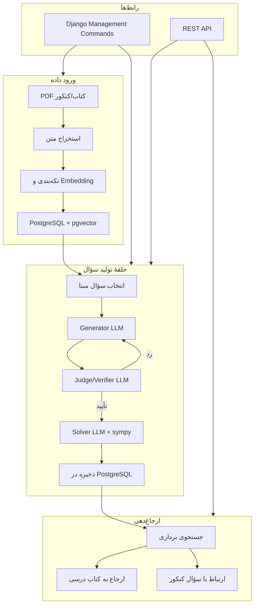

# معماری — تصمیمات فنی

وضعیت: استک اصلی انتخاب شده؛ جزئیات پیاده‌سازی در فاز ۰ مشخص می‌شود.

## استک فنی

| لایه | انتخاب | توضیح |
| --- | --- | --- |
| زبان | Python | اکوسیستم قوی ML/NLP، سرعت توسعه |
| فریم‌ورک وب | Django + Django REST Framework | معماری API-first برای سایت آینده (فاز ۳) |
| پایگاه داده | PostgreSQL + pgvector | رابطه‌ای + جستجوی برداری برای embedding و ارجاع‌دهی |
| اجرای محلی | Docker Compose | محیط یکسان توسعه و تست |
| CLI | Django management commands | دستورهای خط فرمان برای ورود داده، تولید سؤال و مدیریت |
| LLM | لایهٔ انتزاعی با پشتیبانی OpenAI | قابلیت تعویض مدل بدون تغییر کد اصلی |

### تنظیمات مدل زبانی (پیشنهاد)

| نقش | مدل پیش‌فرض | قابل تنظیم |
| --- | --- | --- |
| Generator | gpt-5.6-luna (OpenAI) | بله |
| Judge/Verifier | مدل جدا با reasoning قابل تنظیم | بله |
| Solver | مدل جدا + حل کدمحور (sympy) | بله |

مدل‌ها پشت یک لایهٔ انتزاعی قرار دارند. تغییر مدل از طریق تنظیمات (بدون تغییر کد) ممکن است. هر نقش مدل و پارامترهای جداگانه دارد.

## الزامات مفهومی

- پشتیبانی از استخراج و سازمان‌دهی سؤال‌های منابع
- پشتیبانی از تولید سؤال بر اساس سؤال‌های موجود
- نگهداری سؤال‌ها به‌صورت موجودیت مستقل
- پشتیبانی از روابط چندبه‌چند برای کنکور مرتبط، منشأ تولید و مباحث مرتبط
- جداسازی این سه مفهوم در مدل، مطابق `data-model.md`
- درنظرگرفتن قابلیت ارجاع پاسخ به کتاب درسی در طراحی محصول

## معماری API-first

در فاز ۱ رابط کاربری وجود ندارد. تمام عملیات از طریق:
- **Django management commands** (برای عملیات دسته‌ای: ورود داده، تولید انبوه)
- **REST API** (برای عملیات تکی و آماده‌سازی برای UI آینده)

در فاز ۳، یک فرانت‌اند وب به API متصل می‌شود.

## نمودار اجزا و جریان داده

## تصمیم‌های باز

- احراز هویت، مجوزها و نقش‌ها (فعلاً نیاز نیست؛ فاز ۳): باز
- محیط استقرار نهایی (سرور، ابر): باز
- محدودیت بودجهٔ API مدل‌های زبانی: باز
- مقیاس داده، هم‌زمانی و نیاز به صف پردازش (مثل Celery): باز

## قاعدهٔ تصمیم‌گیری

انتخاب‌های این سند ممکن است پس از تست اولیه و بازخورد تغییر کنند. ایجنت نباید موارد باز را به‌عنوان تصمیم قبلی کاربر معرفی کند.
