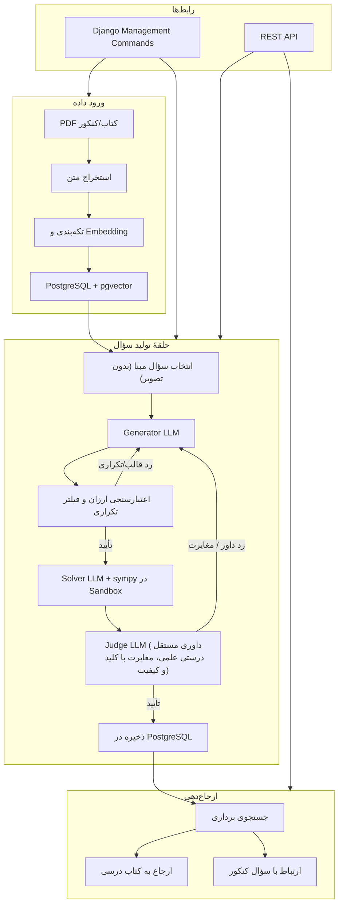

# معماری — تصمیمات فنی

وضعیت: استک اصلی انتخاب شده؛ جزئیات پیاده‌سازی در فاز ۰ مشخص می‌شود.

> **دامنهٔ آموزشی پروژه:** پایهٔ دوازدهم متوسطهٔ دوم، دروس ریاضی، فیزیک و شیمی برای دو رشتهٔ ریاضی و تجربی (جزئیات در `mvp-scope.md`).

## استک فنی

| لایه | انتخاب | توضیح |
| --- | --- | --- |
| زبان | Python | اکوسیستم قوی ML/NLP، سرعت توسعه |
| فریم‌ورک وب | Django + Django REST Framework | معماری API-first برای سایت آینده (فاز ۳) |
| پایگاه داده | PostgreSQL + pgvector | رابطه‌ای + جستجوی برداری برای embedding و ارجاع‌دهی |
| اجرای محلی | Docker Compose | محیط یکسان توسعه و تست |
| CLI | Django management commands | دستورهای خط فرمان برای ورود داده، تولید سؤال و مدیریت |
| LLM | لایهٔ انتزاعی با پشتیبانی OpenAI | قابلیت تعویض مدل بدون تغییر کد اصلی |

### تنظیمات مدل زبانی (پیشنهاد)

| نقش | مدل پیش‌فرض | قابل تنظیم |
| --- | --- | --- |
| Generator | gpt-5.6-luna (OpenAI) | بله |
| Judge/Verifier | مدل جدا با reasoning قابل تنظیم | بله |
| Solver | مدل جدا + حل کدمحور (sympy) | بله |

مدل‌ها پشت یک لایهٔ انتزاعی قرار دارند. تغییر مدل از طریق تنظیمات (بدون تغییر کد) ممکن است. هر نقش مدل و پارامترهای جداگانه دارد. برای کاهش ریسک خطای هم‌جهت، Generator و Judge باید الزاماً از خانواده‌های متفاوتی باشند.

## الزام Sandbox برای اجرای کد

اجرای کد محاسباتی (مانند حل نمادین مسائل با `sympy` در گام Solver) باید در یک محیط ایزوله (Sandbox) انجام شود:
- **بدون دسترسی شبکه:** ایزولاسیون کامل کانتینر یا محیط اجرا از اینترنت و شبکهٔ داخلی.
- **محدودیت زمان اجرا:** سقف زمانی اجرا (پیشنهاد: حداکثر ۱۰ ثانیه) برای جلوگیری از توقف سیستم یا حملات DoS محاسباتی.
- **محدودیت حافظه:** سقف مصرف رم (پیشنهاد: ۵۱۲ مگابایت).
- **فهرست سفید کتابخانه‌ها:** دسترسی انحصاری به کتابخانه‌های محاسباتی مجاز (مانند `sympy`, `numpy`, `scipy` — پیشنهاد).
- **بدون دسترسی دیسک و محیط:** عدم دسترسی به فایل‌های پروژه، فایل‌های سیستمی یا متغیرهای محیطی حاوی کلیدهای محرمانه.
- **ثبت کامل لاگ:** ضبط ورودی کد، خروجی و پیام‌های خطا برای ممیزی کیفی و امنیتی.
- *پیشنهاد ابزار اجرایی:* باز (نیازمند ارزیابی در فاز ۰).

## انتخاب مدل Embedding

تصمیم‌گیری دربارهٔ مدل Embedding باید **پیش از طراحی و نهایی‌سازی طرح پایگاه داده در فاز ۰** انجام شود؛ چرا که بُعد وکتور (Vector Dimension) مستقیماً ساختار ستون‌های وکتور در `pgvector` را تعیین می‌کند.

### معیارهای انتخاب
- **پشتیبانی قوی از زبان فارسی:** درک صحیح معنایی، لغات تخصصی و مفاهیم کتاب‌های درسی ایران.
- **پشتیبانی از ساختار فرمول‌ها و عبارات علمی:** هم‌پوشانی برداری بین متون حاوی فرمول‌های ریاضی و شیمی.
- **بُعد وکتور:** توازن میان دقت بازنمایی، حافظهٔ رم موردنیاز ایندکس، و سرعت جستجوی شباهت در PostgreSQL.
- **هزینه و سرعت:** تأخیر در تولید بردار و هزینهٔ مالی API به‌ازای هر تکه متن (Chunk).

> تصمیم نهایی: **باز** — باید در آزمایش امکان‌سنجی فاز ۰ با تست مدل‌های کاندید روی نمونه‌های متنی تعیین شود.

## الزامات مفهومی

- پشتیبانی از استخراج و سازمان‌دهی سؤال‌های منابع در موجودیت مستقل `source` (شامل ناشر، سال، نوبت و نام آزمون) و اتصال سؤال‌ها به آن؛ سؤال‌های تولیدشده فاقد منبع آزمونی مستقیم هستند (`source_id = null`).
- پشتیبانی از تولید سؤال بر اساس سؤال‌های موجود با ثبت کامل شواهد و نوع تغییر در `generation_sources`
- نگهداری سؤال‌ها به‌صورت موجودیت مستقل (عدم استفاده از `parent_id` یا ساختار درختی میان سؤال‌ها)
- پشتیبانی از روابط چندبه‌چند برای کنکور مرتبط (`related_exam_questions`)، منشأ تولید (`generation_sources`) و مباحث مرتبط (`question_to_topic`)
- جداسازی این سه مفهوم در مدل، مطابق `data-model.md`
- ثبت تفکیک‌شدهٔ سنجش خودکار در `verification_methods` (منحصراً با مقادیر `code`, `grounded`, `llm_only`) و تفکیک کامل آن از فیلدهای تأیید انسانی (`human_verified*`)
- تفکیک تطابق Solver با کلید (`solver_agreement` و `solver_matches_key`) از رأی، نمره و استدلال مستقل داور (Judge)؛ داور با Solver توافق نمی‌کند بلکه مستقلاً داوری می‌نماید.
- درنظرگرفتن قابلیت ارجاع پاسخ به کتاب درسی در طراحی محصول (`textbook_references`) با تفکیک نقش مرجع مطالعه از سند اثبات کلید

## معماری API-first و فازبندی

در فاز ۱ رابط کاربری وب وجود ندارد و تولید سؤال صرفاً به‌صورت متنی و بدون تصویر و شکل انجام می‌شود. تمام عملیات از طریق:
- **Django management commands** (برای عملیات دسته‌ای: ورود داده، تولید انبوه)
- **REST API** (برای عملیات تکی و آماده‌سازی برای UI آینده)

در فاز ۲، قابلیت ورودی تصویر (عکس سؤال یا پاسخ استاد) و پشتیبانی از سؤال‌های تصویردار افزوده می‌شود.  
در فاز ۳، یک فرانت‌اند وب (سایت کاربری و آزمون آنلاین) به API متصل شده و سامانه به پایه‌های دهم و یازدهم گسترش می‌یابد.

## نمودار اجزا و جریان داده

## تصمیم‌های باز

- احراز هویت، مجوزها و نقش‌ها (فعلاً نیاز نیست؛ فاز ۳): باز
- محیط استقرار نهایی (سرور، ابر): باز
- محدودیت بودجهٔ API مدل‌های زبانی: باز
- مقیاس داده، هم‌زمانی و نیاز به صف پردازش (مثل Celery): باز
- مدل دقیق Embedding و ابعاد وکتور آن (پیش‌شرط فاز ۰): باز
- ابزار پیشنهادی برای محیط ایزولهٔ Sandbox: باز

## قاعدهٔ تصمیم‌گیری

انتخاب‌های این سند ممکن است پس از تست اولیه و بازخورد تغییر کنند. ایجنت نباید موارد باز را به‌عنوان تصمیم قبلی کاربر معرفی کند.
