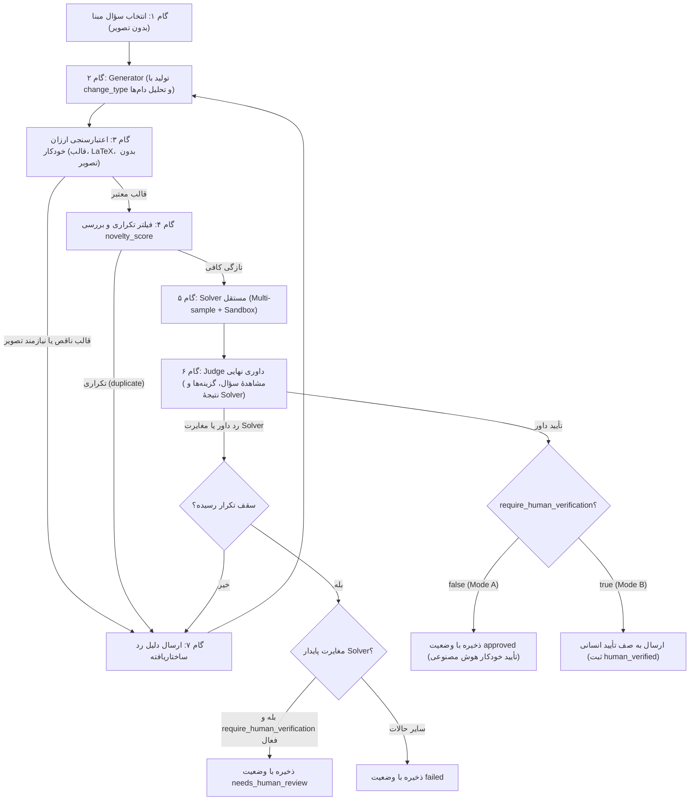

# تولید سؤال

## هدف

سیستم از سؤال‌های موجود در منابع برای ساخت سؤال‌های جدید و مشابه استفاده می‌کند تا برای طراحی سؤال به استادان کنکور متکی نباشد.

## اصول مدل داده

- سؤال تولیدشده، موجودیتی مستقل است.
- سؤال می‌تواند چند سؤال مبنای تولید داشته باشد.
- سؤال مبنای تولید لزوماً از کنکور نیست؛ منابع مؤسسات هم می‌توانند مبنا باشند.
- مبنای واقعی تولید با سؤال کنکور مرتبط یکسان نیست.
- سؤال تولیدشده می‌تواند هیچ سؤال کنکور مرتبطی نداشته باشد یا با چند سؤال کنکور مرتبط باشد.
- سؤال می‌تواند چند مبحث یا فصل را پوشش دهد.
- ارتباط یا شباهت، به‌تنهایی اثبات نمی‌کند که سؤال از روی سؤال دیگری ساخته شده است.

---

## تأیید انسانی (اختیاری و قابل‌تنظیم)

فرایند تأیید انسانی یک قابلیت اختیاری و قابل‌پیکربندی است و نباید اجباری فرض شود. سیستم در دو حالت عمل می‌کند:

### حالت الف — بدون تأیید انسانی (پیش‌فرض MVP — Mode A)
- وضعیت `approved` صریحاً و منحصراً به‌معنی **«تأیید خودکار هوش مصنوعی»** است.
- وضعیت `approved` متضمن هیچ‌گونه صحت علمی قطعی نیست و هرگز به‌معنای تأیید انسانی نمی‌باشد.
- خروجی این حالت برای بررسی‌های داخلی، تست‌های سیستمی و بهبود مدل‌ها کاربرد دارد، اما نباید به‌عنوان خروجی تأییدشدهٔ انسانی معرفی شود.
- **الزام مستندسازی و API:** «در تمام مستندات و خروجی API، وضعیت approved به‌معنی تأیید خودکار هوش مصنوعی است؛ این وضعیت صحت علمی تضمین‌شده نیست و تأیید انسانی نشده است.»

### حالت ب — با تأیید انسانی (اختیاری بر اساس تنظیمات — Mode B)
- متغیر سیستمی: `require_human_verification` (بولین، پیش‌فرض: `false`).
- در صورت فعال بودن (`true`)، فقط سؤال‌هایی که `human_verified=true` دارند در خروجی نهایی محصول و API عمومی به نمایش درمی‌آیند.
- فیلدهای تکمیلی در این حالت:
  - `human_verified` (بولین): آیا سؤال توسط بازبین انسانی تأیید شده است؟
  - `human_verified_by` (متن): شناسهٔ بازبین انسانی.
  - `human_verified_at` (تاریخ/ساعت): زمان تأیید انسانی.
- **رابطه با وضعیت `needs_human_review`:**
  - وضعیت `needs_human_review` یعنی سیستم هوش مصنوعی در درستی سؤال یا تطابق Solver با کلید دچار تردید شده و نیازمند بررسی انسانی است.
  - اگر `require_human_verification=true` باشد، تمام سؤال‌ها برای ورود به خروجی نهایی باید از تأیید انسانی عبور کنند.
  - اگر `require_human_verification=false` باشد، سؤال‌های دارای وضعیت `needs_human_review` در سیستم ثبت و در لاگ‌ها نگهداری می‌شوند تا در صورت نیاز بررسی شوند، اما مانع ادامهٔ تولید یا خروجی‌های خودکار داخلی نمی‌شوند.

---

## پوشش تأیید بر اساس نوع سؤال

روش اعتبارسنجی سؤال باید با ماهیت علمی آن متناسب باشد. جدول زیر نحوهٔ بررسی هر نوع سؤال را نشان می‌دهد:

| نوع سؤال | روش تأیید | قابلیت اطمینان تقریبی (پیشنهاد) |
| --- | --- | --- |
| عددی (محاسباتی) | Solver مستقل + حل با کد (`sympy`) در Sandbox | بالا |
| مفهومی (چهارگزینه) | ارجاع و تطبیق با کتاب درسی (Textbook Grounding) + Judge | متوسط |
| استدلالی / تحلیلی | Judge + نمونه‌گیری چندگانهٔ Solver (Multi-sample Voting) | متوسط–پایین |
| معادله / واکنش شیمیایی | Solver + `sympy` (در صورت امکان) + Judge | متوسط |
| اثبات / هندسه | Judge (استفادهٔ محدود از `sympy`) | پایین |

### تطبیق کتاب درسی برای سؤال‌های مفهومی (Textbook Grounding)
برای سؤال‌های مفهومی که ابزارهای محاسباتی (مانند `sympy`) روی آن‌ها کاربرد ندارند:
- کلید پاسخ صحیح باید مستقیماً با یک تکه (chunk) مشخص و مرتبط از کتاب درسی پشتیبانی شود.
- شناسه و محتوای بخش پشتیبان‌کننده (supporting chunk) همراه با سؤال در جدول `textbook_references` ذخیره می‌شود.
- در صورتی که هیچ بخش پشتیبان‌کننده‌ای در متن کتاب‌های درسی پیدا نشود:
  - اگر `require_human_verification=true` باشد: وضعیت سؤال `needs_human_review` می‌شود.
  - اگر `require_human_verification=false` باشد: وضعیت سؤال `failed` شده و با کد رد `no_grounding` برچسب می‌خورد.

### روش‌های خودکار سنجش (`verification_methods`)
برای هر سؤال تولیدشده، روش‌های خودکار سنجش در فیلد چندمقدارهٔ `verification_methods` ثبت می‌شوند. مقادیر مجاز منحصراً سه‌گانه هستند:
- `code`: تأیید از طریق اجرای محاسباتی با کد در Sandbox (`sympy`)
- `grounded`: تأیید از طریق تطبیق مستند با کتاب درسی (Textbook Grounding)
- `llm_only`: تأیید صرفاً از طریق مدل‌های زبانی (بدون ابزار خارجی یا متن کتاب)

> **قاعدهٔ تفکیک تأیید انسانی از روش‌های سنجش خودکار:**  
> تأیید انسانی (`human`) هرگز جزو مقادیر `verification_methods` نیست و در فیلدهای کاملاً تفکیک‌شدهٔ انسانی (`human_verified*`) ثبت می‌شود. یک سؤال می‌تواند به‌طور هم‌زمان چندین روش سنجش خودکار داشته باشد (مثلاً هم `code` و هم `grounded`). ساختار ذخیره‌سازی این ویژگی چندمقداره (آرایه در PostgreSQL یا جدول واسط) به‌صورت «پیشنهاد — باز» است.

### الزامات Sandbox برای اجرای کد
برای اجرای کد اعتبارسنجی Solver (مانند اسکریپت‌های `sympy`):
- ایزولاسیون کامل و بدون هرگونه دسترسی به شبکه (Network-disabled).
- محدودیت زمان اجرا (Timeout): پیشنهاد ۱۰ ثانیه.
- محدودیت حافظه (RAM Limit): پیشنهاد ۵۱۲ مگابایت.
- فهرست سفید کتابخانه‌ها: صرفاً کتابخانه‌های ریاضی استاندارد مانند `sympy`, `numpy`, `scipy` (پیشنهاد).
- بدون دسترسی به فایل‌های سیستمی یا متغیرهای محیطی سیستم‌عامل.
- ثبت ورودی دقیق کد، خروجی استاندارد (`stdout`) و خطای استاندارد (`stderr`) برای هر بار اجرا جهت ممیزی و ردگیری.

---

## حلقهٔ تولید و داوری (Adversarial LLM Loop)

حلقهٔ تولید شامل ۷ گام منظم و متوالی است. تقدم گام‌های ارزان و سریع بر مدل‌های گران، هزینه و مصرف توکن را به حداقل می‌رساند:

> **چرا گام‌های ارزان در ابتدا قرار دارند؟**  
> گام‌های ۳ و ۴ (اعتبارسنجی ساختاری/قالب و فیلتر شباهت برداری) بدون نیاز به فراخوانی مدل‌های زبانی گران‌قیمت یا حل‌کننده‌های چندمرحله‌ای اجرا می‌شوند. اگر یک سؤال دارای فرمت ناقص، کاراکترهای خراب LaTeX، نقض شرط تصویر یا شباهت بسیار زیاد با سؤالات قبلی باشد، فوراً و با کمترین هزینه رد می‌شود و از اتلاف بودجه روی Solver و Judge جلوگیری به‌عمل می‌آید.

### گام ۱ — انتخاب سؤال مبنا
- سؤال مبنا از دیتابیس انتخاب می‌شود.
- **محدودیت فاز ۱:** سؤال‌هایی که دارای `has_figure=true` هستند از چرخهٔ انتخاب سؤال مبنا برای تولید مستثنا هستند.
- معیار انتخاب: قابل تنظیم (پیشنهاد: ترکیب پوشش موضوعی مباحث و توزیع سؤال‌های موجود).

### گام ۲ — Generator: تولید سؤال با نوع تغییر صریح
> **نکتهٔ فاز ۱:** در فاز ۱، Generator فقط سؤال‌های بدون تصویر (صرفاً متن و فرمول) تولید می‌کند. سؤال‌های مبنا با `has_figure=true` از استخراج تولید خارج هستند.

Generator بر اساس سؤال مبنا، سؤال جدید را به‌همراه نوع تغییر مشخص (`change_type`) تولید می‌کند:
- مقادیر استاندارد `change_type`:
  - `number_change`: تغییر متغیرها و داده‌های عددی مسئله.
  - `statement_change`: تغییر صورت مسئله و زاویهٔ بیان سناریو.
  - `condition_change`: افزودن یا تغییر یک شرط اولیه یا قید فیزیکی/شیمیایی.
  - `decomposition`: خردکردن مسئله به گام‌ها یا خرده‌سؤال‌های ساده‌تر.
- خروجی Generator شامل موارد زیر است:
  - متن سؤال
  - گزینه‌های چهارگانه
  - کلید پاسخ صحیح
  - راه‌حل گام‌به‌گام
  - مقدار `change_type`
  - توضیح گزینه‌های غلط (تحلیل خطای دانش‌آموز برای هر گزینهٔ غلط)

> **یادداشت برای سؤال‌های خردشده (`change_type=decomposition`):** Generator در این حالت یک سری سؤال خردشده می‌سازد. ترتیب و رابطهٔ آن‌ها از طریق `question_set` (پیشنهاد) یا فقط `generation_sources` (بدون لینک صریح) ثبت می‌شود — تصمیم باز (ر.ک. `data-model.md`).

### گام ۳ — اعتبارسنجی ارزان خودکار (قبل از مدل‌های گران)
این مرحله یک بررسی سریع و کم‌هزینه مبتنی بر قوانین و اعتبارسنج‌های متنی است:
- آیا ساختار پاسخ کامل است؟ (متن سؤال، ۴ گزینه، کلید پاسخ، و راه‌حل موجودند)
- آیا فرمول‌های LaTeX به‌درستی پارس می‌شوند و خطای نگارشی ندارند؟
- آیا دقیقاً یک گزینه به‌عنوان پاسخ درست معرفی شده است؟
- آیا سؤال نیاز به تصویر دارد؟ (`has_figure` نباید `true` باشد؛ در فاز ۱ سؤالات نیازمند شکل مجاز نیستند).
- در صورت عدم تأیید، سؤال بدون مصرف منابع گران‌قیمت با کدهای مناسب رد می‌شود (`incomplete_format` یا `figure_required`).

### گام ۴ — فیلتر تکراری (Vector Similarity)
- **سطح اول (مقایسه با سؤال مبنا):** متن و ساختار سؤال جدید با بردار سؤال مبنا مقایسه می‌شود. اگر شباهت بالاتر از آستانه باشد، سؤال نوآوری کافی نداشته و رد می‌شود.
- **سطح دوم (مقایسه با کل بانک و دستهٔ تولیدی جاری):** بردار سؤال با تمام سؤال‌های بانک و سؤال‌های تولیدشده در همان دسته مقایسه می‌شود تا از انباشت سؤال‌های هم‌پوشان و تکراری جلوگیری شود.
- **بررسی ساختاری ساده برای نسخه‌های عددی:** اگر فقط اعداد تغییر کرده باشند اما مفهوم و گام‌های حل کاملاً یکسان باشند، این موضوع شناسایی و امتیازدهی می‌شود.
- فیلد کنترلی: `novelty_score` (عدد اعشاری بین ۰ تا ۱؛ آستانهٔ قبولی: پیشنهاد — باز). اگر نمره کمتر از آستانه باشد، با کد `duplicate` رد می‌شود.

### گام ۵ — Solver مستقل (بدون دیدن کلید)
- یک مدل جداگانه بدون دسترسی به کلید پاسخ یا راه‌حل Generator، صورت سؤال را به‌طور مستقل حل می‌کند.
- **رأی‌گیری چندنمونه‌ای (Multi-sample Voting / Self-consistency):** مدل حل‌کننده چندین بار با دمای کنترل‌شده اجرا می‌شود و پاسخ نهایی از طریق رأی‌گیری تعیین می‌گردد.
- **فیلد `solver_agreement`:** سهم آرای حل‌کننده در نمونه‌گیری چندگانه که با کلید پاسخ طراح مطابقت دارند (عددی بین ۰ تا ۱؛ آستانهٔ قبولی پیشنهادی: باز). توافق Solver با کلید پاسخ سنجیده می‌شود، نه با داور.
- **فیلد `solver_matches_key`:** آیا پاسخ نهایی Solver مستقل با کلید معرفی‌شده توسط Generator مطابقت دارد یا خیر.
- برای سؤال‌های محاسباتی و عددی (ریاضی، فیزیک، شیمی): هم‌زمان کد حل تحلیلی (`sympy`) در Sandbox امن اجرا می‌شود تا صحّت ریاضی را بدون خطای توهم زبانی بسنجد.

### گام ۶ — Judge (داور)
- داور متن سؤال، گزینه‌ها، کلید Generator، راه‌حل، و **نتیجهٔ Solver مستقل (شامل تطابق/مغایرت با کلید، راه‌حل ساندباکس و کدهای خطا)** را مشاهده و ارزیابی می‌کند.
- **شفاف‌سازی رابطهٔ داور با Solver:** داور خروجی Solver را مشاهده می‌کند اما با آن «توافق» نمی‌کند؛ بلکه داور حکم مستقل، نمره (`judge_score`) و استدلال (`judge_reasoning`) خود را صادر می‌نماید.
- معیارهای ارزیابی داور:
  - درستی علمی: عدم وجود خطای فیزیکی، شیمیایی یا محاسباتی.
  - یکتایی پاسخ: عدم وجود دو پاسخ درست یا ابهام در بین گزینه‌ها.
  - تطابق آموزشی: هم‌خوانی با سرفصل دوازدهم، کتاب درسی و سطح آزمون کنکور.
  - تکراری‌نبودن: اطمینان از اصالت سؤال نسبت به سؤال‌های موجود.
  - کامل‌بودن قالب: تناسب متن، گزینه‌ها و شفافیت راه‌حل تشریحی.
  - کیفیت گزینه‌های غلط: بررسی هدفمندبودن گزینه‌های انحرافی بر اساس خطاهای رایج.
- خروجی داور: رأی تأیید یا رد، امتیاز `judge_score`، استدلال `judge_reasoning`، و در صورت رد، فهرست `reject_reason_codes`.

### گام ۷ — بازخورد ساختاریافته یا ذخیره
- **در صورت تأیید داور:**
  - اگر `require_human_verification=false`: ذخیره با وضعیت `approved` (تأیید خودکار AI).
  - اگر `require_human_verification=true`: ارسال برای بررسی انسانی با وضعیت اولیه `approved` و انتظار برای `human_verified=true`.
- **در صورت رد داور یا بروز مغایرت:**
  - اگر هنوز سقف تکرار حلقه پر نشده باشد: ارسال بازخورد ساختاریافته (کدهای دلیل رد + راه‌حل و اختلاف نظر Solver) به Generator جهت بازتولید یا اصلاح در تکرار بعدی.
  - اگر سقف تکرار پر شده باشد: ثبت سؤال با وضعیت نهایی (`failed` یا در صورت مغایرت معنادار و فعال بودن بازبینی انسانی `needs_human_review`).

---

### نمودار بازطراحی‌شدهٔ حلقهٔ تولید

---

## مدیریت مغایرت Solver با کلید

- **مغایرت در تلاش اول:** راه‌حل و پاسخ Solver به‌همراه کلید Generator به Generator بازگردانده می‌شود؛ زیرا ممکن است کلید Generator اشتباه بوده یا متن سؤال دچار ابهام باشد.
- **مغایرت پایدار (پس از رسیدن به سقف تکرار):**
  - اگر `require_human_verification=true` باشد: سؤال با وضعیت `needs_human_review` ذخیره می‌شود تا کارشناس انسانی اختلاف را حل کند.
  - اگر `require_human_verification=false` باشد: سؤال با وضعیت `failed` ذخیره می‌شود و مانع خروجی نخواهد شد.
- مقادیر `solver_agreement` (سهم آرای موافق با کلید در رأی‌گیری چندنمونه‌ای) و `solver_matches_key` (تطابق بولی پاسخ نهایی Solver با کلید) در رکورد سؤال و موجودیت `generation_attempts` ذخیره می‌شوند تا سطح قطعیت و تاریخچهٔ حل مشخص باشد (آستانهٔ حداقلی توافق: باز).

---

## کیفیت گزینه‌های غلط (Distractor Quality)

گزینه‌های انحرافی نباید گزینه‌های تصادفی، بی‌ربط یا بدیهی باشند:
- هر گزینهٔ غلط باید با یک **خطای شناختی یا محاسباتی محتمل دانش‌آموز** متناظر باشد (مانند: اشتباه در علامت منفی/مثبت، عدم تبدیل یکاها، اعمال نادرست فرمول، غفلت از شرط مرزی مسئله).
- Generator موظف است در خروجی ساختاریافتهٔ خود، نوع خطای متناظر با هر گزینهٔ غلط را تصریح کند.
- Judge در مرحلهٔ داوری کیفیت گزینه‌های غلط و منطقی‌بودن گزینه‌های انحرافی را سنجیده و در صورت ضعف، سؤال را رد می‌کند.

---

## کدهای استاندارد دلیل رد (`reject_reason_codes`)

هنگام رد سؤال در مراحل مختلف، یک یا چند کد استاندارد در فیلد `reject_reason_codes` ذخیره می‌شوند:

| کد دلیل رد | شرح مفهوم |
| --- | --- |
| `scientifically_incorrect` | پاسخ، راه‌حل یا صورت سؤال از نظر علمی و درسی غلط است. |
| `multiple_answers` | بیش از یک گزینه می‌تواند از نظر منطقی یا علمی درست باشد. |
| `ambiguous` | صورت سؤال مبهم، دوپهلو یا فاقد داده‌های لازم برای حل یکتا است. |
| `duplicate` | سؤال با سؤال مبنا یا سؤال‌های موجود بانک تکراری است یا شباهت بسیار بالایی دارد. |
| `out_of_topic` | سؤال خارج از سرفصل، پایه یا مبحث هدف طراحی شده است. |
| `incomplete_format` | ساختار سؤال، گزینه‌ها، کلید، راه‌حل تشریحی یا کد LaTeX ناقص یا خراب است. |
| `figure_required` | حل سؤال نیازمند تصویر، نمودار یا شکل هندسی است (ممنوع در فاز ۱). |
| `no_grounding` | سؤال مفهومی فاقد پشتیبان متنی مستند در کتاب درسی است. |
| `poor_distractors` | گزینه‌های غلط بی‌کیفیت، بدیهی یا فاقد خطای آموزشی هستند. |
| `solver_mismatch` | مغایرت پایدار و حل‌نشده میان پاسخ Solver مستقل و کلید Generator. |

---

## کنترل هزینه و ایمنی

برای جلوگیری از هدررفت بودجه، ایجاد حلقه‌های نامتناهی یا رفتارهای ناامن مدل‌ها:
- `retry_cap`: سقف تعداد تکرار مجاز برای یک سؤال (پیشنهاد: ۳ بار).
- `cost_cap_per_question`: سقف هزینهٔ مجاز توکن برای تولید یک سؤال مشخص (پیشنهاد: باز).
- `cost_cap_per_batch`: سقف بودجهٔ مالی کل برای اجرای یک دسته (Batch) تولیدی.
- **ردگیری مصرف:** ثبت تعداد توکن‌های ورودی/خروجی و محاسبهٔ فیلد `cost` (به دلار) در هر چرخه.
- **قطع حلقه‌های غیرهمگرا:** در صورتی که Generator در دو تلاش متوالی یک خطای تکراری را بازتولید کند، فرایند فوراً متوقف و وضعیت `failed` اعمال می‌شود.
- در صورت رسیدن به سقف هزینهٔ دسته، اجرای دستورات به‌صورت خودکار متوقف می‌گردد.

---

## الزام تنوع مدل (Model Diversity)

- **الزام قطعی طراحی:** مدل مورد استفاده برای Generator و مدل مورد استفاده برای Judge باید از دو **خانوادهٔ مدل کاملاً متفاوت** (مثلاً OpenAI در برابر Anthropic یا Google) یا حداقل از دو معماری و پیکربندی با رفتارهای تفکیک‌شده باشند.
- **دلیل:** در صورت استفاده از یک خانوادهٔ مدل مشترک، ریسک بروز **خطای هم‌جهت (Correlated Errors)** به‌شدت افزایش می‌یابد؛ بدین معنا که پیش‌داوری‌ها، توهم‌ها یا ضعف‌های استدلالی مشترک باعث می‌شود Judge خطای فاحش Generator را تأیید کند.
- مدل Solver نیز باید کاملاً مستقل از Generator و Judge انتخاب شده و برای مسائل عددی با اجرای کدمحور در Sandbox همراه باشد.

---

## متریک‌های سلامت حلقه (برای گزارش و نظارت)

سیستم باید متریک‌های زیر را برای ارزیابی پایداری و سلامت فرایند تولید ثبت کند:
- **نرخ تأیید (Approval Rate):** نسبت سؤال‌های تأییدشده به کل سؤال‌های تولیدشده.
- **میانگین تکرار (Average Retries):** میانگین تعداد دورهای حلقه تا تأیید سؤال.
- **نرخ مغایرت Solver:** درصد سؤال‌هایی که با اختلاف کلید و Solver مواجه شده‌اند.
- **هزینهٔ هر سؤال approved:** هزینهٔ دلاری واقعی صرف‌شده به‌ازای هر سؤال پذیرفته‌شده.
- **توزیع کدهای دلیل رد:** نمودار فراوانی کدهای `reject_reason_codes` جهت شناسایی گلوگاه‌های کیفی Generator.

---

## فیلدهای ذخیره‌سازی سؤال تولیدشده

| فیلد | نوع | توضیح |
| --- | --- | --- |
| `status` | متن (enum) | وضعیت: `draft` / `approved` / `needs_human_review` / `failed` (توضیح: `approved` منحصراً به‌معنی تأیید خودکار هوش مصنوعی است؛ فاقد تضمین صحت علمی و فاقد تأیید انسانی) |
| `judge_score` | عدد اعشاری | امتیاز کلی داور |
| `judge_reasoning` | متن | استدلال، نقد و ارزیابی مستقل داور |
| `solver_answer` | متن | پاسخ نهایی Solver مستقل |
| `solver_matches_key` | بولین | آیا پاسخ Solver با کلید Generator مطابقت دارد یا خیر |
| `solver_agreement` | عدد اعشاری (۰–۱) | سهم آرای Solver در رأی‌گیری چندنمونه‌ای که با کلید مطابقت دارند (توافق با کلید، نه داور) |
| `novelty_score` | عدد اعشاری | نمرهٔ تازگی نسبت به سؤال‌های موجود |
| `verification_methods` | فهرست رشته‌ها (چندمقداره) | روش‌های خودکار سنجش سؤال؛ انحصاری از مقادیر `code` / `grounded` / `llm_only`. مقدار `human` در این فیلد قرار نمی‌گیرد. |
| `reject_reason_codes` | فهرست رشته | کدهای خطای ردشده در ارزیابی |
| `change_type` | متن (enum) | نوع تغییر: `number_change` / `statement_change` / `condition_change` / `decomposition` |
| `cost` | عدد اعشاری | هزینهٔ تولید سؤال (دلار) |
| `retry_count` | عدد صحیح | تعداد دفعات تکرار حلقه |
| `generator_model` | متن | شناسهٔ مدل Generator |
| `judge_model` | متن | شناسهٔ مدل Judge |
| `solver_model` | متن | شناسهٔ مدل Solver |
| `prompt_version` | متن | نسخهٔ پرامپت |

---

## تنظیمات پیش‌فرض مدل‌ها (پیشنهاد)

| نقش | مدل پیشنهادی | قابل تنظیم |
| --- | --- | --- |
| Generator | gpt-5.6-luna (یا مدل پیشرفتهٔ هم‌رده) | بله |
| Judge | مدل از خانوادهٔ متفاوت با قابلیت Reasoning بالا | بله |
| Solver | مدل مستقل + `sympy` در Sandbox برای محاسباتی | بله |

---

## تصمیم‌های باز

- نوع دقیق تغییرات و حدود تغییر مجاز در هر مبحث: باز
- روش انتخاب سؤال‌های مبنا (وزن‌دهی بر اساس کمبود در مبحث): باز
- آستانهٔ عددی دقیق برای `novelty_score` و `solver_agreement`: باز
- سقف بودجه مالی به‌ازای هر سؤال و هر دسته (Batch Budget): باز
- ساختار دادهٔ دقیق `question_set` در برابر رویکرد بدون لینک صریح: باز
- ابزار پیشنهادی Sandbox برای اجرای ایمن پایتون: باز

---

## محدودیت فعلی

در فاز ۱، تولید سؤال منحصراً به سؤال‌های متنی و فرمولی بدون تصویر محدود است. در حالت پیش‌فرض بدون بازبینی انسانی، برچسب `approved` صرفاً یک تأییدیهٔ خودکار هوش مصنوعی است و محصول در این فاز ادعای تضمین درستی علمی برای عرضهٔ مستقیم به دانش‌آموز را ندارد.
