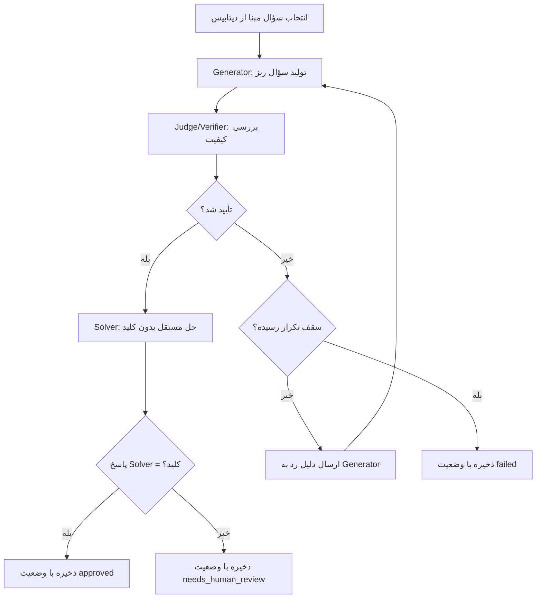

# تولید سؤال

## هدف

سیستم از سؤال‌های موجود در منابع برای ساخت سؤال‌های جدید و مشابه استفاده می‌کند تا برای طراحی سؤال به استادان کنکور متکی نباشد.

## اصول مدل داده

- سؤال تولیدشده، موجودیتی مستقل است.
- سؤال می‌تواند چند سؤال مبنای تولید داشته باشد.
- سؤال مبنای تولید لزوماً از کنکور نیست؛ منابع مؤسسات هم می‌توانند مبنا باشند.
- مبنای واقعی تولید با سؤال کنکور مرتبط یکسان نیست.
- سؤال تولیدشده می‌تواند هیچ سؤال کنکور مرتبطی نداشته باشد یا با چند سؤال کنکور مرتبط باشد.
- سؤال می‌تواند چند مبحث یا فصل را پوشش دهد.
- ارتباط یا شباهت، به‌تنهایی اثبات نمی‌کند که سؤال از روی سؤال دیگری ساخته شده است.

## حلقهٔ تولید و داوری (Adversarial LLM Loop)

به‌جای GAN کلاسیک، از دو مدل زبانی در نقش‌های تخاصمی استفاده می‌شود:

### ۱. انتخاب سؤال مبنا

سؤال مبنا از دیتابیس انتخاب می‌شود. معیار انتخاب (تصادفی، بر اساس مبحث، یا بر اساس کمبود سؤال در یک حوزه) قابل تنظیم است.

### ۲. Generator (تولیدکننده)

Generator بر اساس سؤال مبنا، «سؤال‌های ریز» می‌سازد:

- **نسخه‌های مشابه:** تغییر اعداد، تغییر صورت مسئله، جابه‌جایی گزینه‌ها، تغییر شرایط اولیه.
- **سؤال‌های خردشده:** شکستن یک سؤال چند مرحله‌ای به مرحله‌های کوچک‌تر و مستقل.
- هر سؤال تولیدشده باید شامل متن سؤال، گزینه‌ها، پاسخ صحیح و راه‌حل گام‌به‌گام باشد.

### ۳. Judge/Verifier (داور — JEV)

داور سؤال تولیدشده را از چند جنبه بررسی می‌کند:

| معیار داوری | توضیح |
| --- | --- |
| درستی علمی | آیا سؤال و پاسخ از نظر علمی صحیح‌اند؟ |
| یکتایی پاسخ | آیا فقط یک گزینه درست است و بقیه قطعاً غلط‌اند؟ |
| تطابق آموزشی | آیا سؤال با پایه، مبحث و سطح دشواری مورد نظر هم‌خوانی دارد؟ |
| تکراری‌نبودن | آیا سؤال کپی یا بازنویسی ساده سؤال مبنا نیست؟ |
| کامل‌بودن قالب | آیا متن، گزینه‌ها، پاسخ و راه‌حل کامل هستند؟ |

### ۴. Solver (حل‌کنندهٔ مستقل)

- یک مدل جداگانه بدون دیدن کلید پاسخ، سؤال را حل می‌کند.
- پاسخ Solver با کلید Generator مقایسه می‌شود.
- برای سؤال‌های عددی (فیزیک، شیمی، ریاضی)، حل با کد (مثلاً `sympy`) نیز انجام می‌شود تا خطای محاسباتی مدل زبانی تشخیص داده شود.
- اگر پاسخ Solver با کلید مغایرت داشته باشد، سؤال به بررسی بیشتر فرستاده می‌شود.

### ۵. حلقهٔ بازخورد

- اگر داور سؤال را رد کند، **دلیل رد** به Generator برمی‌گردد.
- Generator می‌تواند سؤال را اصلاح کند یا سؤال جدید بسازد.
- **سقف تکرار** (مثلاً ۳ بار) قابل تنظیم است؛ پس از رسیدن به سقف، سؤال با وضعیت `failed` ذخیره می‌شود.

### ۶. خروجی و وضعیت

هر سؤال تولیدشده با اطلاعات زیر ذخیره می‌شود:

| فیلد | توضیح |
| --- | --- |
| `status` | وضعیت: `draft` / `approved` / `needs_human_review` / `failed` |
| `judge_score` | امتیاز کلی داور (عددی) |
| `judge_reasoning` | دلیل و توضیح داور برای هر معیار |
| `retry_count` | تعداد دفعات تکرار حلقه |
| `generator_model` | مدل و نسخه‌ای که سؤال را ساخته |
| `judge_model` | مدل و نسخه‌ای که داوری کرده |
| `prompt_version` | نسخهٔ پرامپت استفاده‌شده |

### نمودار حلقهٔ تولید

## ریسک‌ها

| ریسک | توضیح | راه کاهش پیشنهادی |
| --- | --- | --- |
| خطای هم‌جهت | وقتی Generator و Judge یک مدل یا خانوادهٔ مدل باشند، ممکن است هر دو یک خطای مشترک داشته باشند و Judge خطای Generator را تشخیص ندهد. | استفاده از مدل‌های متفاوت برای Generator و Judge؛ اضافه‌کردن Solver کدمحور برای سؤال‌های عددی. |
| ضعف مدل ارزان در داوری | مدل‌های ارزان‌تر ممکن است توانایی کافی برای تشخیص خطاهای ظریف علمی را نداشته باشند. | استفاده از مدل قوی‌تر (با reasoning بالاتر) برای Judge؛ بررسی دوره‌ای نمونه‌های approved توسط انسان. |
| کیفیت پایین سؤال‌های خردشده | خردکردن سؤال ممکن است سؤال‌های بی‌معنی یا خیلی ساده تولید کند. | تعریف معیار حداقل پیچیدگی در پرامپت Judge. |

## تنظیمات پیش‌فرض مدل‌ها (پیشنهاد)

| نقش | مدل پیشنهادی | قابل تنظیم |
| --- | --- | --- |
| Generator | gpt-5.6-luna | بله |
| Judge | مدل جدا با reasoning بالاتر | بله |
| Solver | مدل جدا + sympy برای عددی | بله |

تصمیم نهایی مدل‌ها پس از تست اولیه و مقایسهٔ هزینه/کیفیت گرفته می‌شود.

## تصمیم‌های باز

- نوع تغییرات مجاز نسبت به سؤال‌های مبنا: باز
- روش انتخاب سؤال‌های مبنا (تصادفی، اولویت‌بندی، بر اساس کمبود): باز
- روش تعیین سطح دشواری و تازگی سؤال: باز
- نقش و درصد بازبینی انسانی (مشورت با قلم‌چی): باز
- معیار دقیق «سؤال خوب» (ضریب تمایز، سبک طراحی): باز (ر.ک. `open-questions.md`)

## محدودیت فعلی

تولیدشدن خروجی به معنی تأیید درستی یا آماده‌بودن آن برای استفاده نیست. معیار پذیرش علمی و روش بررسی هنوز تعیین نشده‌اند.
